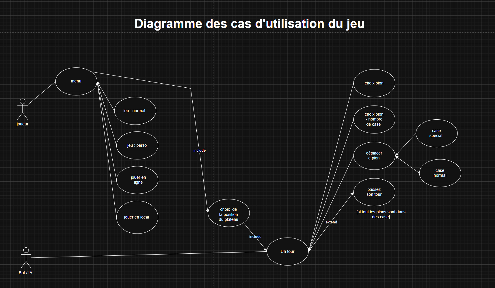
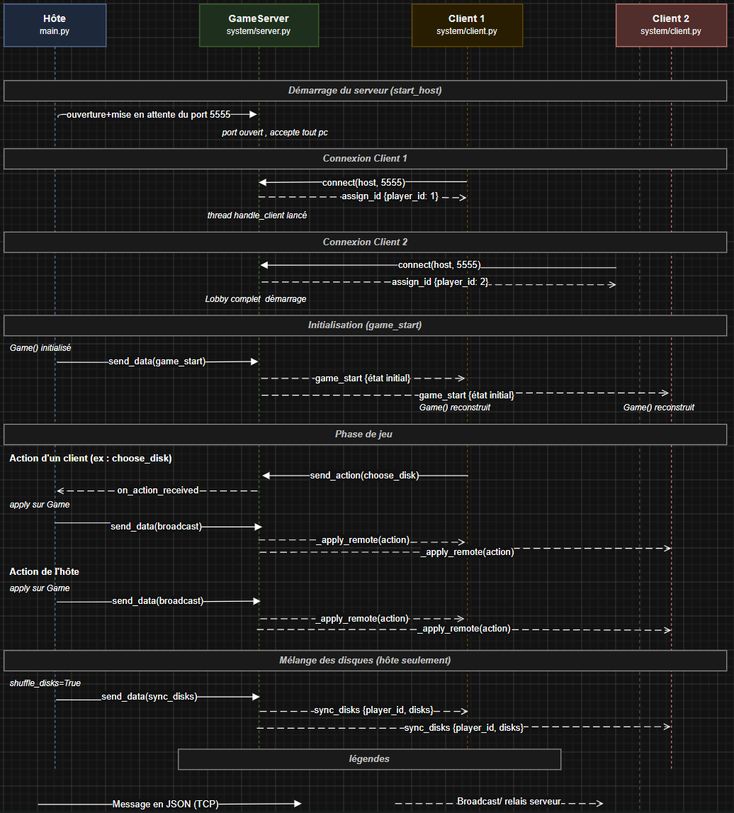

# Taupes & Cie (taupeNco)

Avant de lire ce document, nous vous recommandons de consulter le manuel utilisateur pour comprendre comment le jeu se déroule.

Adaptation numérique du jeu de société **Taupes & Cie**, développée en Python avec une interface graphique Tkinter. Le projet couvre une partie locale (solo, multijoueur sur un même poste) et un mode réseau.

## Contexte et choix techniques

Ce dépôt reflète le travail d'une équipe dont les membres n'avaient pas tous le même niveau en Python. Certaines parties du code utilisent un typage plus strict (`list[int]`, annotations de retour, etc.) tandis que d'autres restent plus directes. Cette hétérogénéité est volontaire et correspond aux compétences de chacun.

**Stack retenue :** **Python + Tkinter**, choix motivé par la simplicité de mise en œuvre pour une interface de jeu de plateau, en cohérence avec le cahier des charges ; **Ruff**, linter configuré dans `pyproject.toml` pour harmoniser les conventions (longueur de ligne, règles de base E/F) et maintenir un code lisible malgré les styles différents.

## Prérequis et lancement

**Dépendances :** Python 3.10+, `Pillow` (affichage des images dans le menu d'orientation), `pygame` (musique du menu), Tkinter (inclus avec la plupart des installations Python).

```bash
pip install pillow pygame
python main.py
```

Le point d'entrée unique est `main.py` : il affiche le menu (`frontend/menu.py`), récupère la configuration de la partie, puis lance le mode correspondant.

## Architecture du projet

```
taupeNco/
├── main.py                 # Point d'entrée, orchestration des modes de jeu
├── entities/               # Logique métier (sans interface)
│   ├── game.py             # Phases, tours, validation des coups, victoire
│   ├── board.py            # Grille hexagonale et pile de plateaux
│   ├── player.py           # Joueur, pions et disques
│   ├── pawn.py             # Pion (position, état)
│   ├── disk.py             # Disques de déplacement
│   └── bot.py              # IA pour le mode solo
├── frontend/               # Interface graphique
│   ├── menu.py             # Menu principal et configuration
│   ├── ui.py               # Interface de jeu (plateau, joueurs, actions)
│   ├── board_position.py   # Orientation des plateaux avant la partie
│   └── waiting.py          # Salle d'attente multijoueur (lobby réseau)
└── system/                 # Services transverses
    ├── server.py           # Serveur TCP (hôte multijoueur)
    ├── client.py           # Client TCP (joueur distant)
    └── save.py             # Sauvegarde / chargement (.tandc)
```

**Séparation des responsabilités :**

| Couche | Rôle |
|--------|------|
| `entities/` | État du jeu, validation des coups : indépendant de Tkinter |
| `frontend/` | Affichage, clics, envoi des actions réseau |
| `system/` | Persistance et communication TCP |
| `main.py` | Lien entre menu, réseau et interface |

### Cas d'utilisation



## Logique métier (`entities/game.py`)

La classe `Game` centralise l'état de la partie (phase, joueur courant, pile de plateaux, sélection disque/pion). Les méthodes exposées sont appelées par l'interface ou le bot ; elles ne dépendent pas de Tkinter.

| Méthode | Rôle |
|---------|------|
| `try_place_current_pawn(row, col)` | Placement d'un pion en phase initiale |
| `try_choose_disk(...)` | Sélection d'un disque en phase mouvement |
| `try_choose_pawn(row, col)` | Sélection du pion à déplacer |
| `try_move_chosen_pawn_to(row, col)` | Exécution du déplacement et gestion du tour suivant |
| `possible_moves(pawn_index, disk_index)` | Calcul des cases atteignables (distance, ligne droite, obstacles) |
| `_finish_disk_cycle(cur, ...)` | Fin de tour de disque : mélange si cycle complet, passage au joueur suivant |
| `prepare_disk_choice(...)` / `enter_disk_choice_phase(...)` | Contrôle avant le choix d'un disque (retournement et mélange si besoin) |
| `check_board_descent()` | Déclenche la descente si tous les trous sont remplis |
| `check_victory()` | Détecte l'occupation du centre |

L'interface (`frontend/ui.py`) traduit les clics en appels à ces méthodes, puis rafraîchit l'affichage via `update_ui()`.

## Disques de déplacement (`entities/disk.py`)

Chaque joueur possède **6 disques** modélisés par `[valeur, visible]`. La valeur indique la distance de déplacement ; `visible=False` correspond à la face cachée (affichée `?` dans l'UI).

Les valeurs dépendent du nombre de plateaux (`DISK_VALUES_BY_BOARDS` dans `disk.py`) :

| Plateaux | Valeurs |
|----------|---------|
| 3 | `[0, 1, 1, 2, 2, 3]` |
| 4 | `[1, 2, 2, 3, 3, 4]` |
| 5 | `[0, 1, 2, 2, 3, 4]` |
| 6 | `[0, 1, 2, 2, 3, 4]` |

Lorsque tous les disques sont visibles, `mix_disks()` les remet face cachée et les mélange. Des garde-fous (`prepare_disk_choice`, `_ensure_disks_shuffled_if_complete`) évitent un état bloqué avec tous les disques déjà retournés.

En multijoueur, **seul l'hôte mélange** ; un message `sync_disks` propage l'état à tous les clients.

## Le plateau hexagonal

### Parcours de conception

La modélisation du plateau a été l'une des parties les plus exigeantes du projet. Nous avons d'abord exploré des ressources en ligne sur les grilles hexagonales, souvent formulées avec des systèmes de coordonnées peu intuitifs. En inclinant visuellement la grille d'environ 30 degrés, nous avons obtenu une illusion de profondeur, un empilement de cubes en 3D, ce qui nous a naturellement orientés vers une grille 3D pour simplifier les déplacements.

Au fil de l'implémentation, nous avons compris que cette intuition correspondait exactement à la **grille hexagonale axiale** : un cube vu en perspective, avec des formules éprouvées qui unifient distance, rotation et alignement. Plutôt que d'appliquer des formules trouvées sans les comprendre, nous sommes arrivés à ce modèle par raisonnement, ce qui garantit une maîtrise complète du système de coordonnées utilisé dans le code.

### Implémentation (`entities/board.py`)

Chaque plateau est un hexagone de **rayon 4** (taille 9), représenté en **coordonnées axiales `(q, r)`** avec la contrainte cubique `s = -q - r`. Le centre est `(0, 0)`. Un `Board` reçoit sa couche, ses marqueurs (`X`, `S`, `J`) et son orientation ; la **`BoardPile`** assemble les couches actives à partir de `_markers_by_layer` et de `board_orientation`.

**Conversions clés :**

| Méthode | Rôle |
|---------|------|
| `axial_to_2d(q, r)` | Projection vers la grille Tkinter (ligne, colonne) |
| `from_2d_to_axial(ligne, colonne)` | Inverse pour les clics souris |
| `hex_distance(q1, r1, q2, r2)` | Distance en cases (`max(|dq|, |dr|, |ds|)`) |
| `is_straight_line(...)` | Vérifie l'alignement sur une des six directions |
| `line_path(...)` | Cases intermédiaires pour détecter les obstacles |
| `rotate_60()` | Rotation des marqueurs lors de l'orientation des plateaux |

### Modélisation 2D pour l'affichage

La logique de jeu s'appuie sur la grille axiale `(q, r)`, mais Tkinter ne dessine pas directement un hexagone : il faut une **matrice 2D** rectangulaire. C'est la deuxième modélisation du plateau, produite par `to_2d_grid()` dans `entities/board.py`.

**Principe :** chaque case axiale valide est projetée en `(ligne, colonne)` via `axial_to_2d`. Les emplacements qui ne correspondent à aucune case hexagonale restent à `None`, ce qui donne la forme en nid d'abeille dans un tableau rectangulaire de **9 lignes x 17 colonnes** (`size` x `2 x size - 1`).

**Valeurs des cellules :**

| Valeur | Signification |
|--------|---------------|
| `None` | Hors plateau (coin du rectangle, pas une case jouable) |
| `0` | Case libre |
| `'X'` | Trou |
| `'S'` | Case spéciale |
| `'J'` | Point de départ du chemin pointillé vers le centre |

Exemple de projection pour la couche "Terre" (chaque ligne correspond à une rangée de la matrice 2D) :

```python
[None, None, None, None, 0, None, 'X', None, 0, None, 'X', None, 0, None, None, None, None]
[None, None, None, 0, None, 0, None, 0, None, 0, None, 0, None, 0, None, None, None]
[None, None, 0, None, 0, None, 0, None, 0, None, 0, None, 0, None, 'X', None, None]
[None, 'X', None, 0, None, 'X', None, 0, None, 0, None, 'X', None, 0, None, 0, None]
[0, None, 0, None, 0, None, 0, None, 'X', None, 0, None, 0, None, 0, None, 0]
[None, 0, None, 0, None, 'X', None, 0, None, 0, None, 'X', None, 0, None, 0, None]
[None, None, 0, None, 0, None, 0, None, 0, None, 'X', None, 0, None, 'X', None, None]
[None, None, None, 'X', None, 0, None, 0, None, 0, None, 0, None, 0, None, None, None]
[None, None, None, None, 0, None, 'X', None, 0, None, 0, None, 0, None, None, None, None]
```

On retrouve ici la structure décalée typique d'un plateau hexagonal vu de face : les cases utiles (`0`, `'X'`, etc.) forment un hexagone, entouré de `None` qui ne sont jamais cliquables.

**Aller-retour entre les deux modèles :** l'interface (`frontend/ui.py`) lit la grille via `to_2d_grid()` pour placer les hexagones et détecter les clics. Quand le joueur clique, les coordonnées `(ligne, colonne)` sont reconverties en `(q, r)` avec `from_2d_to_axial`, puis transmises à la logique de jeu (`try_place_current_pawn`, `try_choose_pawn`, etc.). Toute la validation (distance, ligne droite, obstacles) reste calculée en coordonnées axiales ; la grille 2D sert uniquement à l'affichage et à la saisie.

**Formules de projection :**

```
ligne   = r + radius
colonne = 2 * q + r + 2 * radius
```

Avec `radius = 4` pour un plateau de taille 9, le centre axial `(0, 0)` tombe en `(4, 8)` dans la matrice 2D.

### Orientation : rotation des marqueurs, pas du plateau entier

Avant le lancement (écran `frontend/board_position.py`, **mode classique uniquement**), chaque couche visible peut être orientée par pas de 60 degrés (valeur de 0 à 5). Visuellement, l'image de prévisualisation du plateau pivote dans le menu, mais côté logique le comportement est différent : **on ne tourne pas la géométrie de l'hexagone**.

La forme du plateau reste fixe : `_generate_grid()` recrée toujours le même ensemble de cases axiales autour du centre `(0, 0)`. Seuls les **marqueurs** (`'X'`, `'S'`, `'J'`) sont déplacés. La méthode `rotate_60()` applique une rotation de +60 degrés aux coordonnées `(q, r)` de chaque marqueur via `_rotate_axial_60`, puis régénère la grille et réassigne les marqueurs avec `_apply_markers()`.

Les cases libres (`0`) occupent toujours les mêmes positions axiales ; seule la disposition des marqueurs change par rapport à cette trame fixe.

À la construction (`Board.__init__`), le paramètre `orientation` enchaîne autant d'appels à `rotate_60()` que nécessaire. L'écran d'orientation expose 4 couches (`layer0` à `layer3`). En mode classique à 4 plateaux, `menu._finish_board_position` préfixe `[0, 0]` aux orientations choisies pour fixer Pierre et Terre à 0 ; la liste complète transmise à `Game` contient 6 entiers.

Les modes personnalisés (3 à 6 plateaux) ne passent pas par cet écran : `board_orientation` reste `[0, 0, 0, 0, 0, 0]`.

Les plateaux sont empilés dans une **`BoardPile`**. L'ordre complet des six couches est : Pierre, Terre, Surface, Terre arable, Sous-sol, Roche mère ; seules les `nb_boards` couches du bas de cette liste sont actives. Le plateau du sommet (`get_top()`) est celui sur lequel on joue. Les marqueurs `S` sont retirés de la couche du sommet au moment de la construction (`offset == 0`).

**Référence externe :** [Hexagonal Grids, Red Blob Games](https://www.redblobgames.com/grids/hexagons/)

## Mode multijoueur réseau

Le multijoueur repose sur des **sockets TCP** en architecture **hôte autoritaire** : l'hôte détient la partie de référence ; les clients envoient leurs intentions, puis appliquent l'état diffusé par le serveur.

### Cycle de vie d'une partie en ligne

1. **Hôte :** `main.start_host()` ouvre la salle d'attente (`frontend/waiting.py`), démarre `GameServer` dans un thread, affiche l'IP locale et le compteur de joueurs. La console affiche `Partie hébergée - IP à partager : {ip}:5555`.
2. **Clients :** `main.start_client()` tente `GameClient.connect(host, 5555)`. En cas d'échec, `waiting.show_connection_failed()` affiche Partie non trouvée.
3. **Lobby :** le serveur accepte jusqu'à `nb_joueurs - 1` clients (l'hôte compte comme joueur 0). Des messages `lobby_update` mettent à jour le compteur sur toutes les machines.
4. **Démarrage :** lobby complet, l'hôte crée la `Game`, envoie `game_start`, branche `on_action_received` sur l'UI, puis lance l'interface.

**Paramètres réseau fixes :**

| Paramètre | Valeur |
|-----------|--------|
| Protocole | TCP (`socket.SOCK_STREAM`) |
| Port | `5555` |
| Écoute hôte | `0.0.0.0` (toutes les interfaces) |
| Format des messages | JSON, terminés par `\n` (UTF-8) |

### Attribution des identifiants

| Joueur | ID | Rôle |
|--------|-----|------|
| Hôte (machine qui crée la partie) | `0` | Applique les règles localement, diffuse les actions |
| 1er client connecté | `1` | Reçoit `assign_id` à la connexion |
| 2e client | `2` | Idem |
| etc. | ... | Jusqu'à 3 clients maximum (4 joueurs au total) |

### Flux de communication



**Côté serveur (`system/server.py`, `GameServer`) :**

1. `bind` + `listen` sur le port 5555.
2. `accept()` en boucle jusqu'à atteindre le nombre de clients requis ; à chaque connexion, envoi de `assign_id` puis diffusion de `lobby_update`.
3. Pour chaque connexion : lancement d'un thread `handle_client` en écoute.
4. Quand un client envoie une action JSON : appel du callback `on_action_received` (branché sur `ui.on_network_message` côté hôte), puis **relai** de l'action à tous les clients via `send_data()`.

**Côté client (`system/client.py`, `GameClient`) :**

1. `connect(host, 5555)`.
2. `listen(callback)` : thread daemon qui lit les messages ligne par ligne et les transmet au callback.
3. `send_action(action)` : envoie une action JSON à l'hôte.

**Orchestration (`main.py`) :**

**`start_host` :** affiche la salle d'attente, démarre le serveur dans un thread d'acceptation, attend le lobby complet, crée la `Game`, branche `game_server.on_action_received = game_ui.on_network_message`, envoie `game_start`, lance l'UI avec `role="host"`.

**`start_client` :** affiche la salle d'attente, tente la connexion (erreur affichée si échec), écoute `lobby_update` puis `game_start`, reconstruit une `Game` à partir des données reçues, lance l'UI avec `role="client"` et `local_player_id` reçu. En cas d'échec ou de Retour, `main()` rouvre le menu.

### Modèle autoritaire et synchronisation

| Rôle | Comportement au clic |
|------|----------------------|
| **Local** | Applique immédiatement sur `Game` |
| **Hôte** | Applique sur sa `Game`, puis diffuse via `send_data()` |
| **Client** | Envoie l'action avec `send_action()` **sans** l'appliquer ; attend le broadcast et applique via `on_network_message()` puis `_apply_remote()` |

Seul le joueur dont `current_player == local_player_id` peut agir en multijoueur (`frontend/ui.py`).

**Mélange des disques :** seul l'hôte mélange (`shuffle_disks=True`). Après un mélange, un message `sync_disks` est diffusé pour aligner l'état des disques de chaque joueur sur toutes les machines.

### Types de messages réseau

| Type | Direction | Contenu / effet |
|------|-----------|-----------------|
| `assign_id` | Serveur vers client | `player_id` attribué à la connexion |
| `lobby_update` | Hôte vers tous | `current`, `max` : joueurs connectés / attendus dans le lobby |
| `game_start` | Hôte vers tous | `nbplayer`, `nbboard`, `current_player`, `players_disks`, `board_orientation` |
| `place_pawn` | Joueur vers tous | `row`, `col` : placement en phase initiale |
| `choose_disk` | Joueur vers tous | `disk_selected` |
| `choose_pawn` | Joueur vers tous | `row`, `col` |
| `move_chosen_pawn_to` | Joueur vers tous | `row`, `col` : déplacement validé |
| `next_player` | Joueur vers tous | Passer le tour ; déclenche `_finish_disk_cycle` |
| `replay_turn` | Joueur vers tous | Rejouer après une case `S` |
| `play_turn` | Joueur vers tous | Reprendre le tour après un passage volontaire (`enter_disk_choice_phase`) |
| `sync_disks` | Hôte vers tous | `player_id`, `disks` : état des disques après mélange |

Les messages sont sérialisés en JSON, encodés en UTF-8, et délimités par un saut de ligne pour permettre la lecture par buffer (`recv` + split sur `\n`).

### Chemins des fichiers réseau

| Fichier | Responsabilité |
|---------|----------------|
| `system/server.py` | `GameServer`, `get_local_ip()`, gestion du lobby, `lobby_update` et relais |
| `system/client.py` | `GameClient`, connexion et écoute asynchrone |
| `main.py` | `start_host()`, `start_client()` : salle d'attente, initialisation et synchronisation |
| `frontend/waiting.py` | Écran d'attente lobby (IP, compteur, erreur connexion) |
| `frontend/ui.py` | `_send_network_action()`, `on_network_message()`, `_apply_remote()` : pont UI / réseau |
| `frontend/menu.py` | Choix hôte / client, saisie IP (`join_online_game`, `check_ip`) |

## Sauvegarde

Les parties peuvent être enregistrées au format **`.tandc`** (JSON) via `system/save.py`.

Sauvegarde par défaut : `save/save.tandc`. Import possible depuis le menu principal. Contenu persisté : joueurs, pions, disques, pile de plateaux, phase, joueur courant, etc.

Le chargement reconstruit une instance `Game` complète sans repasser par le menu de configuration.

## Modes de jeu (configuration)

| Mode | `connexionmode` | `gamemode` | Particularités techniques |
|------|-----------------|------------|---------------------------|
| Classique local / réseau | `local` / `multiplayer` | `classic` | 4 plateaux, écran d'orientation |
| Personnalisé local / réseau | `local` / `multiplayer` | `custom` | 3 à 6 plateaux, pas d'écran d'orientation |
| Solo vs bot | `local` | `solobot` | 1 joueur humain, IA dans `entities/bot.py` |
| Multijoueur local | `local` | `classic` ou `custom` | `nbplayer > 1`, tour par tour sur un seul écran |
| Sauvegarde | `save` | - | Reprise d'un fichier `.tandc` via `start_from_save()` |

Le menu remplit `game_config` ; `main.py` route vers `start_local`, `start_host`, `start_client` ou `start_from_save` selon ces clés.

## Interface graphique (Tkinter)

L'interface repose entièrement sur **Tkinter**, bibliothèque standard de Python. Aucun framework UI externe n'est utilisé pour le jeu lui-même (seuls `Pillow` et `pygame` interviennent pour les images du menu d'orientation et la musique d'accueil). Le dossier `frontend/` contient **quatre modules** complémentaires, chacun gérant une fenêtre ou un écran distinct.

| Fichier | Classe | Rôle |
|---------|--------|------|
| `menu.py` | `Menu` | Menu principal, choix du mode de jeu, configuration, import de sauvegarde |
| `waiting.py` | `Waiting` | Salle d'attente multijoueur (lobby réseau avant le lancement) |
| `ui.py` | `Interface` | Écran de partie : plateau, joueurs, disques, actions |
| `board_position.py` | `Boards` | Écran d'orientation des plateaux avant le lancement |

Les ressources visuelles (icônes de trous, portraits de joueurs, pelle, sortie) sont dans `frontend/ressources/`.

### Organisation des fenêtres

**Principe général :** chaque écran crée une fenêtre `tk.Tk()` ou s'intègre dans un `Frame` parent. La mise en page repose sur `grid()` ou `pack()`, et le dessin dynamique (plateau hexagonal, cartes joueurs) passe par des **`Canvas`** Tkinter redessinés à chaque changement d'état.

**Navigation du menu (`Menu`) :** plusieurs pages sont empilées dans la même fenêtre via `tkraise()`. L'utilisateur parcourt : accueil (local, solo, multijoueur, import), configuration du mode choisi, puis éventuellement l'orientation des plateaux. À la fermeture du menu, `display()` retourne le dictionnaire `game_config` lu par `main.py`.

**Écran de partie (`Interface`) :** fenêtre 1400x800 découpée en trois colonnes :

| Zone | Frame | Contenu |
|------|-------|---------|
| Gauche | `frame_left` | Cartes des joueurs, statut, disques visibles |
| Centre | `frame_center` | Plateau hexagonal dessiné sur un `Canvas`, pions, marqueurs |
| Droite | `frame_right` | Phase en cours, disques cliquables, boutons d'action, écran de victoire |

### Fonctions principales du menu (`frontend/menu.py`)

| Méthode | Rôle |
|---------|------|
| `_build_pages()` | Construit toutes les pages (accueil, local, solo, multijoueur, orientation) |
| `_build_game_mode_page(...)` | Génère une page de configuration (nombre de joueurs, nombre de plateaux) |
| `set_connexion_local()` / `set_connexion_multiplayer()` / `set_connexion_solo()` | Enregistre le mode de connexion dans `game_config` |
| `_show_board_position(...)` | Affiche l'écran d'orientation avant de lancer la partie (classique uniquement) |
| `_finish_board_position(orientations)` | Préfixe `[0, 0]` si 4 plateaux, puis finalise la configuration |
| `_start_game(...)` | Remplit `game_config` (joueurs, plateaux, IP hôte) et ferme le menu |
| `create_local_classic()` / `create_solo_classic()` / `create_multiplayer_classic()` | Lance le flux classique avec écran d'orientation |
| `join_online_game()` | Valide l'IP saisie (`check_ip`) et prépare le mode client |
| `display()` | Boucle principale `mainloop()`, retourne `game_config` |

### Fonctions principales de l'interface de jeu (`frontend/ui.py`)

Le cœur de l'affichage est la méthode **`update_ui()`** : elle reconstruit les trois colonnes en appelant `left()`, `center()` et `right()`, puis planifie le tour du bot si besoin.

| Méthode | Rôle |
|---------|------|
| `update_ui()` | Point central de rafraîchissement après chaque action |
| `left()` | Dessine les cartes joueurs sur un `Canvas` (disques, pions restants, joueur actif) |
| `center()` | Gère le plateau : création, descente de couche, redessin des pions |
| `_setup_center_board()` | Construit le `Canvas` central, dessine la grille 2D, lie le clic souris |
| `_redraw_center_pawns()` | Met à jour la position des pions sans reconstruire tout le plateau |
| `_reload_center_board()` | Détruit et reconstruit le plateau après une descente de couche |
| `right()` | Affiche la phase, les disques cliquables, les boutons (passer, rejouer, jouer) |
| `_on_disk_click(idx)` | Gère le choix d'un disque en phase mouvement |
| `_is_disk_shuffle_authority()` | Indique si cette machine peut mélanger les disques (hôte ou local) |
| `_send_disk_sync_if_needed()` | Diffuse `sync_disks` après un mélange côté hôte |
| `change_player_and_update()` / `replay_turn_and_update()` / `play_turn_and_update()` | Boutons de sous-phase, avec envoi réseau si multijoueur |
| `_schedule_bot_turn()` / `_run_bot_turn()` | Délai puis appel à l'IA (`entities/bot.py`) en mode solo |
| `_popup_quitter()` / `_quit_and_save()` | Fenêtre modale de sortie ; en ligne : boutons Annuler / Quitter uniquement ; en local : sauvegarde `.tandc` possible |
| `on_network_message(msg)` / `_apply_remote(msg)` | Réception et application des actions réseau (via `root.after` pour rester thread-safe avec Tkinter) |
| `displayInterface()` | Lance la boucle `mainloop()` de la partie |

**Gestion des clics sur le plateau :** la fonction interne `gerer_clic` (dans `_setup_center_board`) convertit la position souris en `(row, col)`, puis appelle les méthodes de `entities/game.py`. En multijoueur, le client envoie l'action sans l'appliquer localement ; l'hôte applique et diffuse.

**Phase choix disque :** avant d'afficher les disques cliquables, l'UI appelle `prepare_disk_choice()` pour garantir qu'au moins un disque est disponible face cachée.

**Mécanisme de redessin :** les `Canvas` utilisent l'événement `<Configure>` pour s'adapter à la taille de la fenêtre. Lors d'un simple déplacement de pion, seuls les pions sont redessinés (`_redraw_center_pawns`) pour éviter de reconstruire toute la grille.

### Salle d'attente (`frontend/waiting.py`)

| Méthode | Rôle |
|---------|------|
| `update_player_count(current, maximum)` | Met à jour le compteur affiché (`2 / 4`) |
| `show_connection_failed()` | Affiche "Partie non trouvée" et le bouton Retour (client) |
| `display()` | Boucle `mainloop()` de la salle d'attente |
| `close()` | Ferme la fenêtre quand le lobby est complet ou après Retour |

Fenêtre 360x480, même charte graphique que le menu. Peut être lancée seule (`__main__`) ou instanciée par `main.py`.

### Écran d'orientation (`frontend/board_position.py`)

| Méthode | Rôle |
|---------|------|
| `hexa_board(frame, layer)` | Affiche la prévisualisation d'une couche avec boutons de rotation |
| `rotate(layer, direction)` | Incrémente l'orientation (0 à 5) et pivote l'image via Pillow (`ImageTk`, redimensionnement 200x200) |
| `get_board_orientation()` | Retourne `[layer0, layer1, layer2, layer3]` ; le menu complète en 6 valeurs pour le mode classique |
| `_finish()` | Valide les orientations et rappelle le callback du menu |

Cet écran peut fonctionner seul (`parent=None`) ou être embarqué dans le menu principal via un `Frame`.

### Lien avec la logique métier

Tkinter ne contient aucune règle de jeu. Chaque interaction utilisateur suit le même schéma :

1. Événement Tkinter (clic, bouton)
2. Appel d'une méthode de `entities/game.py`
3. `update_ui()` pour refléter le nouvel état

En multijoueur, une couche réseau s'intercale entre les étapes 2 et 3 pour les clients distants. Le fil d'écoute socket tourne en arrière-plan ; les messages sont appliqués sur le thread principal via `root.after(0, ...)` pour respecter les contraintes de Tkinter.

## Qualité de code

Le linter **Ruff** est configuré dans `pyproject.toml` (règles E et F, longueur de ligne 88). Il sert de référence commune pour garder le projet cohérent, indépendamment des différences de style entre contributeurs.
